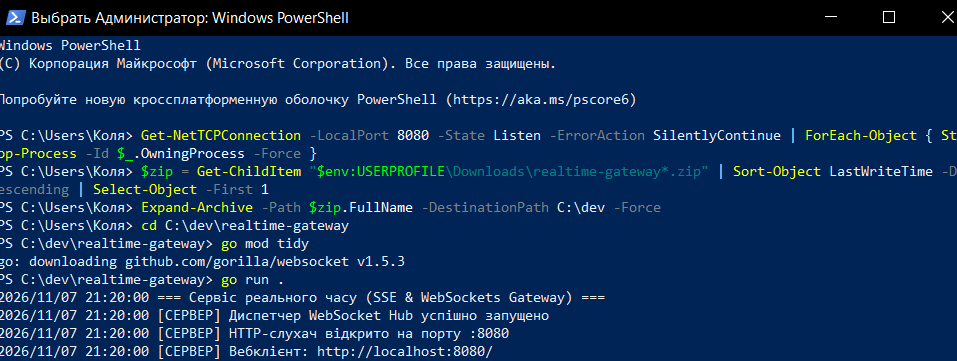
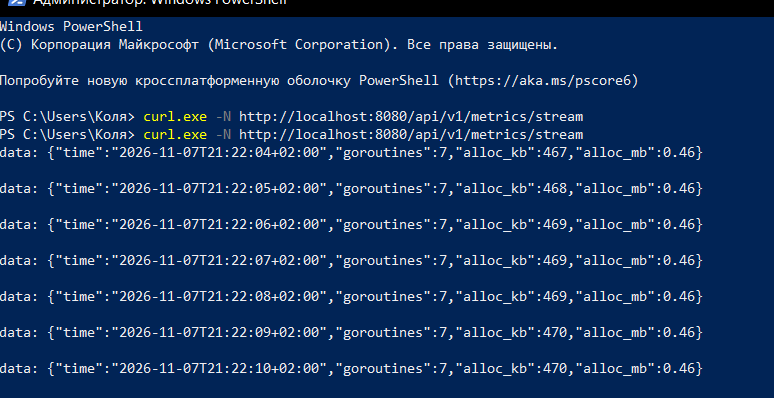
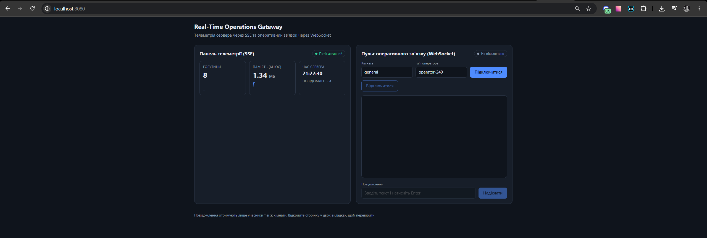
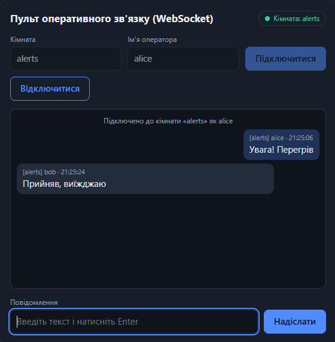
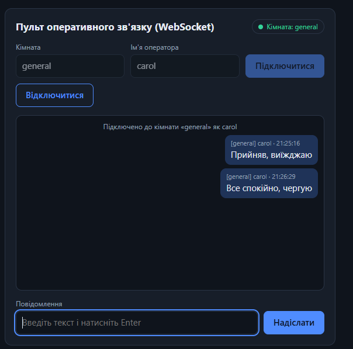
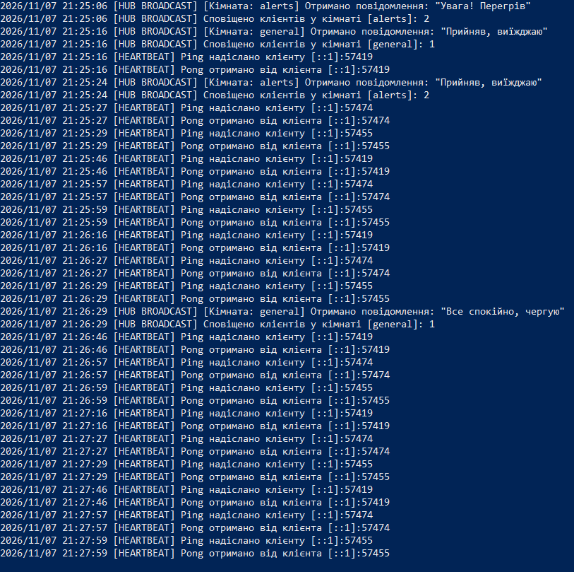
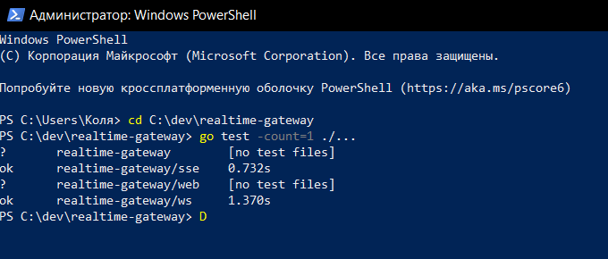

# Практична робота № 6. Комунікація в реальному часі засобами SSE та WebSockets

**Real-Time Operations Gateway** — сервіс моніторингу та оперативного зв'язку реального часу на Go.

Сервіс поєднує два режими передачі даних:

- **SSE (Server-Sent Events):** односпрямована трансляція метрик сервера (час, кількість горутин, виділена пам'ять) щосекунди.
- **WebSocket:** повнодуплексний канал зв'язку операторів на базі патерну **Hub** з тематичними кімнатами та контролем життєздатності з'єднань (**Heartbeat Ping/Pong**).

Для перевірки є вебклієнт, який віддається самим сервером. Реалізовано всі три рівні завдання.

## Технології

- Go 1.22+ (стандартна бібліотека `net/http`, маршрути з методами `GET /path`)
- [`gorilla/websocket`](https://github.com/gorilla/websocket) для WebSocket (RFC 6455)
- Вебклієнт: чистий HTML/CSS/JavaScript (`EventSource`, `WebSocket`), вбудований у виконуваний файл через `embed`

## Структура проєкту

```
.
├── main.go            # запуск, маршрути, graceful shutdown
├── sse/
│   └── metrics.go     # SSE-обробник метрик (http.Flusher, r.Context().Done())
├── ws/
│   ├── hub.go         # Hub: реєстрація, дереєстрація, розсилка по кімнатах
│   ├── client.go      # Client: readPump, writePump, Heartbeat
│   └── handler.go     # апгрейд HTTP -> WebSocket, вибір кімнати
├── web/
│   ├── index.html     # вебклієнт: панель телеметрії та пульт зв'язку
│   └── embed.go
└── screenshots/       # скриншоти для звіту
```

## Запуск

```bash
go mod tidy    # завантажує залежності та створює go.sum
go run .       # сервер на порту 8080
```

Вебклієнт: **http://localhost:8080/**

Порт можна змінити змінною середовища `PORT`. Тести: `go test ./...`.

## Ендпоінти

| Метод | Шлях | Опис |
|---|---|---|
| `GET` | `/api/v1/metrics/stream` | SSE-потік метрик (раз на секунду) |
| `GET` | `/api/v1/ws?room=<кімната>&name=<ім'я>` | WebSocket-з'єднання |
| `GET` | `/` | вебклієнт |

Параметри `/api/v1/ws` (обидва необов'язкові):

- `room`: назва кімнати, 1–32 символи `A-Za-z0-9_-`. За замовчуванням `general`. Некоректна назва повертає `400` до апгрейду.
- `name`: ім'я відправника (до 32 символів). За замовчуванням адреса клієнта.

### Формат даних

SSE-подія (`Content-Type: text/event-stream`, кожна подія завершується порожнім рядком):

```
data: {"time":"2026-11-07T10:00:01+02:00","goroutines":8,"alloc_kb":2450,"alloc_mb":2.39}
```

Клієнт WebSocket надсилає звичайний текст, а сервер розсилає всім учасникам **тієї ж кімнати** (включно з відправником) повідомлення у форматі JSON:

```json
{"room":"alerts","sender":"alice","text":"Увага! Перегрів вузла node-03","time":"2026-11-07T10:00:05+02:00"}
```

## Архітектура

**SSE (рівень 1).** Обробник перевіряє підтримку `http.Flusher`, виставляє заголовки `text/event-stream`, `no-cache`, `keep-alive` і щосекунди (`time.NewTicker`) збирає метрики через `runtime` (`time.Now`, `NumGoroutine`, `MemStats`), серіалізує їх у JSON і виштовхує в сокет через `Flush()`. Розрив з'єднання клієнтом відстежується через `<-r.Context().Done()`: обробник завершується, таймер зупиняється (`ticker.Stop()`), горутина не витікає.

**Hub (рівень 2).** Єдина горутина `Hub.Run()` володіє мапою `clients map[*Client]bool` і в нескінченному циклі через `select` обробляє канали `register`, `unregister` та `broadcast`. Оскільки мапу змінює лише ця горутина, м'ютекси не потрібні. При дереєстрації канал `send` клієнта закривається (рівно один раз).

**readPump / writePump.** `websocket.Conn` не потокобезпечний для запису, тому кожне з'єднання обслуговують дві горутини: `readPump` лише читає з сокета й передає повідомлення в `hub.broadcast`, а `writePump` єдина пише в сокет повідомлення з буферизованого каналу `send` (256 повідомлень).

**Кімнати (рівень 3).** `Client` має поле `room`, а `Message` містить кімнату та відправника. Hub розсилає повідомлення лише клієнтам із тією ж кімнатою. Якщо буфер `send` клієнта переповнений (повільний клієнт), його відключають, щоб він не гальмував решту.

**Heartbeat (рівень 3).** `writePump` кожні **30 с** надсилає Ping-фрейм. `readPump` виставляє `SetReadDeadline` на **45 с** і продовжує його в `SetPongHandler` при кожному Pong. Якщо клієнт не відповів, `ReadMessage` повертає помилку, `readPump` завершується і «завислий» сокет закривається.

**Зупинка.** При `Ctrl+C` скасовується базовий контекст сервера (SSE-обробники завершуються), Hub закриває всі WebSocket-з'єднання кодом 1000, після чого викликається `http.Server.Shutdown`.

### Примітки

- `CheckOrigin` повертає `true`, як вимагає завдання (з'єднання з будь-яких доменів). У виробничому середовищі тут потрібен список дозволених джерел.
- У `http.Server` навмисно не задано `WriteTimeout`: він обірвав би довготривалі SSE-потоки.
- Тексти повідомлень у вебклієнті виводяться через `textContent`, тому розмітка в повідомленнях інших користувачів не виконується.

## Тести

Автоматичні тести (`go test ./...`) перевіряють:

- SSE: заголовки, формат подій, завершення обробника після розриву з'єднання клієнтом, відмову без `http.Flusher`;
- Hub: розсилку лише в межах кімнати, кімнату за замовчуванням, відхилення некоректної назви кімнати, дереєстрацію при розриві;
- Heartbeat: відключення клієнта, що не відповідає на Ping, і збереження з'єднання клієнта, що відповідає;
- коректне закриття з'єднань при зупинці Hub.

## Результати роботи

### Запуск сервера

Консоль запуску: Hub запущено, HTTP-слухач відкрито, помилок немає:



### Рівень 1. SSE-потік метрик

`curl -N` показує, що нові події приходять щосекунди без переривання сесії:



### Вебклієнт: панель телеметрії (SSE)

Вебсторінка, яку віддає сервер: панель телеметрії отримує метрики через `EventSource` (статус «Потік активний»), показники оновлюються щосекунди:



### Рівень 2 та 3. Пульт зв'язку: кімнати

Вкладка 1: кімната `alerts`, оператор `alice`. У чаті повідомлення двох операторів однієї кімнати (своє виділене праворуч, повідомлення `bob` ліворуч):



Вкладка 3: кімната `general`, оператор `carol`. Повідомлення з `alerts` сюди не доходять, видно лише власні:



### Консоль сервера: Hub та Heartbeat

Розсилка повідомлень лише в межах кімнати (у `alerts` сповіщено 2 клієнтів, у `general` один) та Heartbeat: сервер кожні 30 секунд надсилає Ping кожному клієнту й отримує Pong:



### Тести



## Висновки

У ході роботи розроблено сервіс реального часу на Go. Реалізовано SSE-трансляцію метрик через `http.Flusher` з коректним завершенням за `r.Context().Done()`, WebSocket-сервер на `gorilla/websocket` із патерном Hub, розділенням читання й запису на `readPump` та `writePump`, тематичними кімнатами та контролем життєздатності з'єднань через Ping/Pong, а також вебклієнт для перевірки обох режимів.
